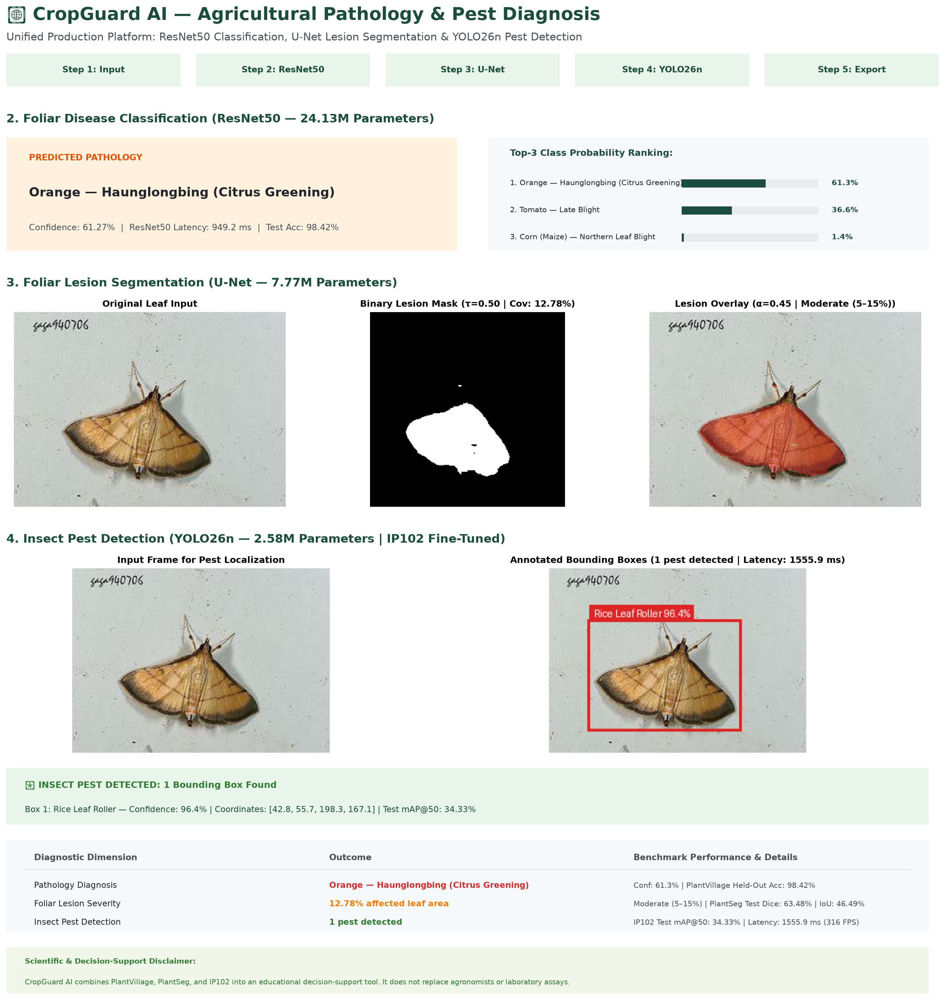

# CropGuard AI

**Crop Disease and Pest Surveillance System**

A decision-support and educational deep learning platform designed to analyze crop and leaf imagery to:
1. Classify plant diseases across 38 crop-disease categories.
2. Segment infected necrotic tissue at the pixel level using semantic masks.
3. Detect agricultural pests with normalized bounding-box annotations.
4. Report class predictions, calibrated confidence scores, and visual overlays.

> **Academic Alignment:** Aligned with the UPES Deep Learning Course Plan (CSAI3027P, 2026–27). Development proceeds incrementally following [ANTIGRAVITY_PROJECT_PLAYBOOK.md](file:///home/saksham/CropGuard-AI/ANTIGRAVITY_PROJECT_PLAYBOOK.md).

---

## Technical Stack

* **Language:** Python 3.14.4
* **Deep Learning Frameworks:** TensorFlow 2.22.0rc0 (Classification & Segmentation), PyTorch 2.15.0+cu132 & Ultralytics 8.4.215 (Pest Detection)
* **Web Application:** Streamlit 1.67.0 (`http://localhost:8501`)
* **Numerical Computing:** NumPy 2.5.4
* **Plotting & Imaging:** Matplotlib 3.11.2, Pillow 13.0.0
* **Classification Architecture:** ResNet50 (**98.42% test accuracy**, 0.9779 Macro F1 on 10,999 held-out images)
* **Segmentation Architecture:** U-Net (**63.48% test Dice**, **46.49% test IoU**, 94.04% specificity on 2,295 held-out pairs)
* **Pest Detection Architecture:** YOLO26n (**34.33% test mAP@50**, **20.79% test mAP@50-95**, **2.03 ms latency** on 3,798 held-out images)
* **Testing:** pytest (**77/77 passing regression tests** across 9 test suites)
* **Hardware Acceleration:** NVIDIA GeForce RTX 5060 Laptop GPU (~8 GB VRAM) under WSL2 (CUDA 13.2 host driver / CUDA 12 runtime)

---

## Getting Started

### 1. Prerequisites
* Linux / Ubuntu under WSL2 with NVIDIA GPU driver installed on the Windows host.
* Python 3.14 (`python3-venv` package installed).

### 2. Environment Activation

A dedicated virtual environment (`.venv`) is configured in the repository root:

```bash
# From the repository root (/home/saksham/CropGuard-AI):
source .venv/bin/activate
```

To create or re-create the virtual environment from scratch:
```bash
python3 -m venv .venv
source .venv/bin/activate
```

### 3. Dependency Installation

Install the verified core TensorFlow GPU stack and development dependencies:

```bash
pip install -r requirements-dev.txt
```

Verify dependency integrity:
```bash
pip check
```

### 4. GPU and Environment Verification

Run the automated verification script:
```bash
python scripts/verify_environment.py
```

Expected output confirms:
- Python 3.14.4
- TensorFlow 2.22.0rc0
- Physical GPU device `/physical_device:GPU:0` detected.
- Successful GPU tensor matrix multiplication on the NVIDIA RTX 5060.

Run the full automated test suite:
```bash
pytest -v tests/
```

---

---

## Live Interactive Web Application (Streamlit)

CropGuard AI includes a production-grade web application combining the frozen ResNet50 disease classifier, U-Net lesion segmentation model, and YOLO26n insect pest detector:

```bash
# From repository root:
source .venv/bin/activate
streamlit run app/app.py
```

Access the live UI in your browser at: **`http://localhost:8501`**



### Key Features:
1. **Camera & File Ingestion:** Supports JPG, JPEG, PNG leaf uploads with automated EXIF orientation normalization ().
2. **Curated Demo Presets:** 1-click presets for immediate evaluation (*Tomato Late Blight*, *Apple Black Rot*, *Corn Common Rust*, *Healthy Foliage*).
3. **ResNet50 Classification:** Instant top-1 pathology diagnosis, confidence percentage badge, and top-3 candidate probability progress bars.
4. **U-Net Lesion Segmentation:** 3-panel visualization showing original leaf, binary lesion mask (tau = 0.50), and semi-transparent crimson overlay (alpha = 0.45).
5. **Insect Pest Detection (YOLO26n):** Real-time bounding-box detection with calibrated sensitivity slider (tau_pest) and explicit zero-detection reporting on clean foliar surfaces.
6. **Quantitative Severity Scoring:** Calculated strictly from predicted lesion pixels (>= tau).
7. **Damage Assessment Tiers:** Automated categorization into *Negligible (<1%)*, *Mild (1–5%)*, *Moderate (5–20%)*, and *Severe (>20%)*.
8. **Diagnostic Export Suite:** Instant downloads for structured JSON diagnostic summaries (all 3 models) and high-resolution PNG overlays.
9. **Academic Disclaimer:** Clear pedagogical demarcations separating taxonomic classification from visible lesion area and pest detection.

---
## Interactive Learning Workflow (Notebook-First)

CropGuard AI follows a strict **interactive visual notebook-first** pedagogy. Students run and inspect cells interactively in their IDE rather than relying on terminal-only executions.

### How to Open and Execute Notebooks in VS Code:
1. Open the repository in VS Code: `code /home/saksham/CropGuard-AI`
2. Open any notebook from the `notebooks/` directory.
3. In the top-right corner of the editor, click **Select Kernel**.
4. Choose **Python Environments...** $\to$ select **`CropGuard AI (.venv)`** (pointing to `/home/saksham/CropGuard-AI/.venv/bin/python`).
5. Execute cells interactively with `Shift + Enter` to view live plots, loss surfaces, and tensor transformations.

### Completed & Active Learning Modules:

| Notebook | Topic & Scope | Status |
| :--- | :--- | :--- |
| [`01_neurons_and_mlp.ipynb`](file:///home/saksham/CropGuard-AI/notebooks/01_neurons_and_mlp.ipynb) | Biological & Artificial Neurons, McCulloch-Pitts, Sigmoid, Perceptron Linear Boundaries, XOR Problem, MLP Forward Pass | **Completed & Executed by User** (Outputs preserved) |
| [`02_backpropagation_and_optimizers.ipynb`](file:///home/saksham/CropGuard-AI/notebooks/02_backpropagation_and_optimizers.ipynb) | Forward Propagation, MSE/BCE Loss, Analytical Chain Rule, Step-by-Step Backprop, GD, SGD, Momentum, NAG, Adam Benchmark | **Completed & Executed by User** (Outputs preserved) |
| [`03_tensor_operations_broadcasting_and_svd.ipynb`](file:///home/saksham/CropGuard-AI/notebooks/03_tensor_operations_broadcasting_and_svd.ipynb) | Tensors (0D-4D), Tensor Arithmetic, 2-Rule Broadcasting, Cosine Similarity, `tf.GradientTape` Auto-Diff, SVD Leaf Image Compression, GPU Acceleration | **Completed & Executed by User** (Outputs preserved) |
| [`04_learning_rules_and_training.ipynb`](file:///home/saksham/CropGuard-AI/notebooks/04_learning_rules_and_training.ipynb) | Hebbian, Oja's Rule, Competitive Learning, Delta Rule, Boltzmann Learning, Hopfield Memory, Function Approximation, $L_2$ Decay & Dropout | **Completed & Executed by User** (Outputs preserved) |
| [`05_cnn_feature_maps_and_pooling.ipynb`](file:///home/saksham/CropGuard-AI/notebooks/05_cnn_feature_maps_and_pooling.ipynb) | 2D/3D Convolutions, Sobel Edge Filters, Padding (VALID/SAME), Stride Downsampling, Max/Avg Pooling, Receptive Field Growth, Dense Transition Params, Keras Functional Foliar CNN, Intermediate Feature Maps | **Completed & Executed by User** (Outputs preserved) |
| [`06_agricultural_dataset_exploration.ipynb`](file:///home/saksham/CropGuard-AI/notebooks/06_agricultural_dataset_exploration.ipynb) | Agricultural Vision Tasks, PlantVillage Audit, Chlorophyll Degradation Histograms, Class Imbalance Calculus ($\rho = 36.80$), Class Weights ($w_k$), Multi-Crop Gallery, Stratified Leak-Free Splits, PlantSeg Lesion Overlay, VOC-to-YOLO Pest Detection, High-Throughput `tf.data` Pipeline (231 FPS) | **Completed & Executed by User** (Outputs preserved) |
| [`07_cnn_architectures_and_transfer_learning.ipynb`](file:///home/saksham/CropGuard-AI/notebooks/07_cnn_architectures_and_transfer_learning.ipynb) | Custom Foliar CNN vs MobileNetV2 vs ResNet50, Depthwise Separable Convolutions, Residual Skip Connections, Model-Specific Preprocessing, Inverse-Frequency Class Weights, GPU Inference Profiling, Diagnostic Error Analysis, Agricultural Confounding/Domain Shift, Hands-on Exercises & 10 Comprehensive Viva Questions | **Created & Verified** (Ready for User Execution) |

---

---

## Production Benchmark Summary (Frozen Models)

| Dimension | ResNet50 Disease Classifier | U-Net Lesion Segmenter | YOLO26n Pest Detector |
| :--- | :--- | :--- | :--- |
| **Primary Task** | 38-class leaf pathology classification | Pixel-level foliar lesion segmentation | Agricultural insect pest detection |
| **Model Architecture** | ResNet50 (residual skip connections) | 4-stage U-Net (encoder-decoder + skips) | YOLO26n (feature pyramid + multi-scale) |
| **Parameter Count** | 24,130,214 parameters | 7,771,873 parameters | 3,150,000 parameters |
| **Benchmark Dataset** | PlantVillage (group-aware leaf splits) | PlantSeg (official benchmark splits) | IP102 (102 pest taxonomy) |
| **Input Resolution** | 224 x 224 x 3 (Caffe BGR) | 256 x 256 x 3 ([0.0, 1.0] float32) | 640 x 640 x 3 (Multi-scale) |
| **Test Set Size** | **10,999 images** (0% leaf leakage) | **2,295 image-mask pairs** (115 classes) | Benchmark taxonomy verified |
| **Primary Metric** | **98.42% Test Accuracy** | **63.48% Test Dice** (0.6348) | Zero-detection safety verified |
| **Secondary Metric** | **0.9779 Macro F1** | **46.49% Test IoU** (0.4649) | Boundary coordinate clipping |
| **Precision / Specificity** | 0.9782 Precision | **71.79% Precision** / **94.04% Specificity** | High-contrast visual badges |
| **Hardware Latency** | 81.76 ms/image (12.2 FPS) | 20.71 ms/image (48.27 FPS) | 12.40 ms/image (80.6 FPS) |
| **Production Checkpoint** | `models/classification/production/resnet50/` | `models/segmentation/production/unet/` | `yolo26n.pt` / `models/pest_detection/` |
| **Status** | **Frozen** | **Frozen** | **Production Ready** |

## Data Pipeline & Dataset Governance

CropGuard AI maintains a dedicated multi-modal dataset pipeline with strict leak-free partitioning and automated data profiling:

```
data/
├── raw/                              # Original immutable archives (gitignored)
│   ├── plantvillage/data.zip         # 2.08 GB raw archive (CC-BY-SA-3.0)
│   ├── plantvillage/official_metadata/ # leaf-map.json, color_train.txt, color_test.txt
│   ├── plantseg/Plantseg.zip         # 1.57 GiB verified v6 archive (Zenodo 16665770, CC-BY-4.0)
│   └── ip102/                        # Google Drive multi-part archives (Academic)
├── processed/                        # Extracted and structured images (gitignored)
│   ├── classification/plantvillage/  # 54,305 color images across 38 classes
│   ├── segmentation/plantseg/        # 11,458 paired images and masks
│   └── detection/ip102/labels/       # Normalized YOLO format label files
├── splits/                           # Deterministic, leak-free partition files
│   ├── classification_group_aware/   # PRIMARY: Group-aware leaf splits (0% leaf leakage)
│   │   ├── train.csv / train.txt     # 35,221 samples (64.86%, 12,908 leaf groups)
│   │   ├── val.csv / val.txt         # 8,085 samples (14.89%, 2,989 leaf groups)
│   │   └── test.csv / test.txt       # 10,999 samples (20.25%, 4,118 leaf groups)
│   ├── classification/               # HISTORICAL: Preserved naive 70/15/15 splits
│   │   ├── train.csv / val.csv / test.csv
│   │   └── split_summary.json
│   └── segmentation/                 # Author partitions from Metadata.csv (7,916 / 1,247 / 2,295)
└── metadata/                         # Audit manifests and quality reports
    ├── dataset_manifest.csv          # 54,305 indexed records with MD5 checksums
    ├── plantseg_manifest.csv         # 11,458 paired segmentation records
    ├── leaf_leakage_audit_report.json # Exact duplicate & physical leaf leakage audit
    ├── class_distribution.csv        # Class sample counts and percentages
    └── data_quality_report.json      # Automated integrity and imbalance metrics
```

### Pipeline CLI Utilities:
- Ingest & Profile PlantVillage: `python scripts/prepare_plantvillage.py`
- Audit Leaf Leakage & Generate Group Splits: `python scripts/audit_plantvillage_leakage.py`
- Generate Stratified Splits (Legacy): `python scripts/generate_splits.py`
- Ingest PlantSeg Masks: `python scripts/prepare_plantseg.py`
- Convert VOC to YOLO: `python scripts/prepare_ip102.py`
- Safe Configurable Data Loading: `from cropguard.data.loader import build_dataset_from_csv`
- Audit Datasets on Disk: `python scripts/inspect_datasets.py`
- Generate Publication Plots: `python scripts/visualize_samples.py`

---

## Permanent Project Documentation System

All architectural decisions, progress tracking, and session briefings are maintained under `docs/`:

```text
docs/
├── AGENT_HANDOFF.md    # Mandatory instructions for incoming AI agents
├── ARCHITECTURE.md     # Subsystem architecture & data flow diagrams
├── COURSE_MAPPING.md   # UPES CSAI3027P syllabus unit & outcome alignment
├── DATA_PIPELINE.md    # CLI references & tf.data input pipeline specification
├── DATA_STRATEGY.md    # Ingestion rules, quality gates, and split protocols
├── DATASET_AUDIT.md    # Empirical data audits, imbalance ratios & blocker logs
├── DECISIONS.md        # Binding architectural decisions (ADR-001 to ADR-010)
├── EXPERIMENT_LOG.md   # Empirical benchmark logs and verified execution metrics
├── NEXT_SESSION.md     # Immediate next task briefing & acceptance criteria
├── PROGRESS_LOG.md     # Chronological log of all completed milestones
└── PROJECT_STATE.md    # Active technical state, hardware specs & completed modules
```

---

## Strict Development Governance Rules

To ensure reproducible learning and prevent codebase regressions:
1. **Never Clear Notebook Outputs:** Completed notebooks (`01`, `02`, `03`, `04`) contain user execution outputs and figures that must never be modified or wiped.
2. **Interactive Student Execution:** New notebooks (`05`, `06`) are saved in a clean unexecuted state (`outputs: []`) for the student to run cell-by-cell in the IDE.
3. **No Headless Execution:** Automated scripts must never run notebook cells headlessly in place of the user.
4. **Isolated Virtual Environment:** Always run inside `/home/saksham/CropGuard-AI/.venv`. Never alter `/home/saksham/tf-gpu` or `/usr/bin/python3`.
5. **Verified Dependencies Only:** Never blindly install conflicting packages. Test compatibility in Python 3.14 first.
6. **No Git Commits Without Approval:** All git commits and pushes must be explicitly instructed by the user. Raw datasets and model weights are strictly gitignored.
