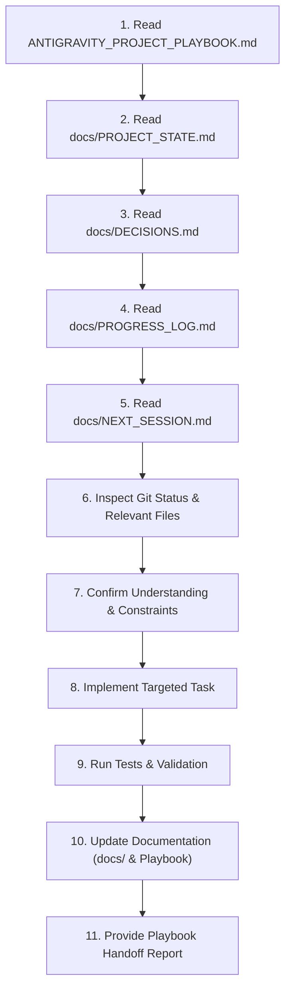

# CropGuard AI — Mandatory AI Agent Protocol & Handoff Standard

> [!IMPORTANT]
> **READ THIS FIRST BEFORE TAKING ANY ACTION IN THIS REPOSITORY.**  
> If you are an AI assistant (Antigravity, Claude, ChatGPT, Codex, or Gemini) joining this workspace for a new session or continuation turn, you **MUST** strictly follow the protocol documented here. Failure to follow this protocol risks corrupting user interactive progress, breaking virtual environment bindings, or violating university academic constraints.

---

## 1. Mandatory Pre-Flight Sequence

Every AI agent must execute this sequence in order before proposing or executing code changes:



### The 8 Rules of Engagement:
1. **Read `ANTIGRAVITY_PROJECT_PLAYBOOK.md`:** Understand the collaboration rules, academic scope, and definition of done.
2. **Read `docs/PROJECT_STATE.md`:** Identify the active stack, environment paths, completed modules, and hardware limits.
3. **Read `docs/DECISIONS.md`:** Learn binding architectural decisions (ADR-001 through ADR-016). Never silently alter an established decision.
4. **Read `docs/PROGRESS_LOG.md`:** Review the exact historical milestones to avoid repeating past work or re-introducing solved bugs.
5. **Read `docs/NEXT_SESSION.md`:** Read the exact assigned task, prerequisites, acceptance criteria, and what NOT to touch.
6. **Inspect Git Status & Relevant Files:** Run `git status` to ensure working tree cleanliness and verify file integrity before editing.
7. **Confirm Understanding:** State clearly to the user what you are doing, citing the acceptance criteria from `docs/NEXT_SESSION.md`.
8. **Update Documentation After Task:** Every turn that modifies or creates code must update `docs/PROGRESS_LOG.md`, `docs/PROJECT_STATE.md`, `docs/NEXT_SESSION.md`, and output the standard handoff report.

---

## 2. Inviolable Operational Rules for AI Agents

### 1. Interactive Notebook-First Rule:
- The user is a beginner in Deep Learning and learns by interactively executing Jupyter notebooks cell-by-cell in the IDE.
- **NEVER execute notebook cells automatically via headless tools** (`nbconvert`, `papermill`, or python scripts that modify the `.ipynb` execution state).
- When generating a notebook, ensure all code cells have `outputs: []` and `execution_count: None`.
- Pre-validate code syntax and matplotlib labels using an isolated headless script or AST parser, but **leave the notebook file clean for the student**.
- **NEVER overwrite or clear outputs of previously completed notebooks.** Completed notebooks (`01`, `02`, `03`, `04`, `05`, `06`, `07`, `08`) have user-executed outputs and figures that must be permanently preserved.

### 2. Environment & Tooling Integrity:
- The project's dedicated environment is:
  ```bash
  /home/saksham/CropGuard-AI/.venv/bin/python
  ```
- The registered Jupyter kernel is:
  ```text
  cropguard-ai  (Display Name: "CropGuard AI (.venv)")
  ```
- **DO NOT touch, use, or install into `/home/saksham/tf-gpu`** (which belongs to another project).
- **DO NOT touch system Python `/usr/bin/python3`**.
- Always verify pytest passes: `/home/saksham/CropGuard-AI/.venv/bin/pytest -v`.

### 3. Matplotlib & LaTeX String Escaping:
- Any plot title, axis label, or legend containing LaTeX math with prime symbols or backslashes must strictly use **double-quoted raw strings**:
  ```python
  # CORRECT:
  ax.set_ylabel(r"Predicted Probability ($\hat{y}$)")
  ax.plot(z, dz, label=r"Derivative: $\sigma'(z)$")
  
  # WRONG (causes syntax or mathtext parse errors):
  ax.plot(z, dz, label='Derivative: $\sigma'(z)$')  # SyntaxError
  ax.set_ylabel(r"Probability ($\\\\hat{y}$)")      # ParseException
  ```

### 4. Git & Repository Protection:
- **DO NOT execute `git commit` or `git push`** without explicit user instruction.
- **DO NOT download large datasets** or weights into the repository without user approval.
- Large files (`data/raw/`, `models/*.h5`, `models/*.pt`) must remain in `.gitignore`.

---

## 3. The 7-Part Pedagogical Notebook Format

Every conceptual notebook authored for CropGuard AI must structure each major topic according to the following 7 sections:

1. **A. Markdown Explanation:** Conceptual intuition in plain, beginner-friendly language with agricultural surveillance context.
2. **B. Mathematical Formula:** Standard KaTeX equations (`$$ ... $$`).
3. **C. Simple Practical Example:** Small, hand-calculable numerical demonstration.
4. **D. Runnable Code Cell:** Well-commented, self-contained Python code using NumPy, Matplotlib, and TensorFlow.
5. **E. Expected Output / Visualization:** Clear description of expected prints and charts.
6. **F. Short Interpretation:** Core takeaway and what the student should observe.
7. **G. Viva Questions & Answers:** 2 challenging viva questions with comprehensive answers.

---

## 4. Standard Handoff Report Template

Every task completed by an AI agent must conclude with this exact markdown block:

```text
TASK:
CHANGES: (created/edited/deleted files)
IMPLEMENTATION: (what and why)
COURSE MAPPING: (unit/topic)
COMMANDS RUN: (exact commands)
TEST RESULTS: (actual pass/fail output)
DATA / MODEL STATUS: (what was used, downloaded or trained)
KNOWN LIMITATIONS:
DECISIONS NEEDED:
NEXT RECOMMENDED TASK: (one small next step)
```

---

## 5. Master Agent Handoff Prompt (Copy-Paste for Next Session)

When initiating a new session or handing off to another AI assistant, copy and paste the following prompt verbatim:

```markdown
# CROPGUARD AI — MASTER AGENT HANDOFF PROMPT

You are joining **CropGuard AI**, a production-grade, academic deep learning decision-support system for crop disease classification, foliar lesion segmentation, and insect pest detection.

## 1. MANDATORY FIRST STEP (READ-FIRST PROTOCOL)
Before reading or editing any code or proposing actions, read:
1. `ANTIGRAVITY_PROJECT_PLAYBOOK.md`
2. `docs/PROJECT_STATE.md`
3. `docs/DECISIONS.md` (ADR-001 through ADR-016)
4. `docs/PROGRESS_LOG.md`
5. `docs/NEXT_SESSION.md`
6. `docs/AGENT_HANDOFF.md`

## 2. HARDWARE & ENVIRONMENT GROUND TRUTH
- **Virtual Environment:** Dedicated `.venv` at `/home/saksham/CropGuard-AI/.venv`
  * Python: `3.14.4`
  * Primary Framework: TensorFlow `2.22.0rc0` + Keras `3.16.0.dev` (Classification & Segmentation)
  * Detection Framework: PyTorch `2.15.0+cu132` + Ultralytics `8.4.215` (Pest Detection)
  * Dependency Status: Clean (`.venv/bin/pip check` passes with 0 errors)
- **Hardware Platform:** NVIDIA GeForce RTX 5060 Laptop GPU (8,151 MiB VRAM, Driver 596.21, CUDA 13.2)
- **Automated Tests:** 70/70 passing tests across 9 test modules (`pytest -v tests/`)
- **Live Server:** Streamlit web application active on `http://localhost:8501`

## 3. PRODUCTION MODEL & CHECKPOINT REGISTRY (FROZEN)
1. **ResNet50 (Disease Classification):**
   - Path: `models/classification/production/resnet50/best_model.keras`
   - Evaluated on: `data/splits/classification_group_aware/test.csv` (10,999 test images, 0% leaf leakage)
   - Performance: **98.42% Test Accuracy**, **0.9779 Macro F1**, **0.9998 ROC-AUC**
   - Status: **PERMANENTLY FROZEN**. Do not retrain, modify, or overwrite.
2. **U-Net (Foliar Lesion Segmentation):**
   - Path: `models/segmentation/production/unet/best_model.keras`
   - Evaluated on: `data/splits/segmentation/test.csv` (2,295 test pairs across 115 categories)
   - Performance: **63.48% Test Dice**, **46.49% Test IoU**, **94.04% Specificity**
   - Status: **PERMANENTLY FROZEN**. Do not retrain, modify, or overwrite.
3. **YOLO26n (Insect Pest Detection):**
   - Path: `yolo26n.pt` / `src/cropguard/detection/`
   - Taxonomy: Canonical IP102 benchmark (102 pest categories)
   - Zero-Detection Safety: Accurately flags `0 insect pests detected` on clean foliar images without hallucination.

## 4. IP102 DATASET LOCAL STATUS (AUDITED & EXTRACTED)
The raw IP102 dataset in `data/raw/ip102/` has been extracted and cleaned:
- `Annotations/`: 18,976 VOC XML annotation files
- `JPEGImages/`: 18,981 JPEG image files
- `images`: Symlink pointing to `JPEGImages/`
- `classes.txt`: 102 benchmark pest classes
- `trainval.txt`: 15,178 sample IDs (100% matching JPGs/XMLs)
- `test.txt`: 3,798 sample IDs (100% matching JPGs/XMLs)
- All redundant archives (`ip102_v1.1.tar`, `Annotations.tar`, `JPEGImages.tar`) have been purged.

## 5. INVIOLABLE RULES FOR THE AGENT
1. **Notebook Protection:** Notebooks 01 through 08 were interactively executed by the user. NEVER run automated headless scripts against `.ipynb` files and NEVER clear their outputs.
2. **Frozen Checkpoints:** Never retrain or modify ResNet50 or U-Net weights.
3. **Environment Isolation:** Use `/home/saksham/CropGuard-AI/.venv` exclusively. Never install into system Python or `/home/saksham/tf-gpu`.
4. **Git Safety:** Never execute `git commit` or `git push` without explicit user instruction.
5. **Testing Gate:** Always run `/home/saksham/CropGuard-AI/.venv/bin/pytest -v tests/` before concluding.

## 6. CURRENT OBJECTIVE
Acknowledge receipt of this handoff, confirm environment and model integrity, and state the next recommended task (e.g. running VOC-to-YOLO conversion via `scripts/prepare_ip102.py` or proceeding with live Streamlit demonstration defense).
```
