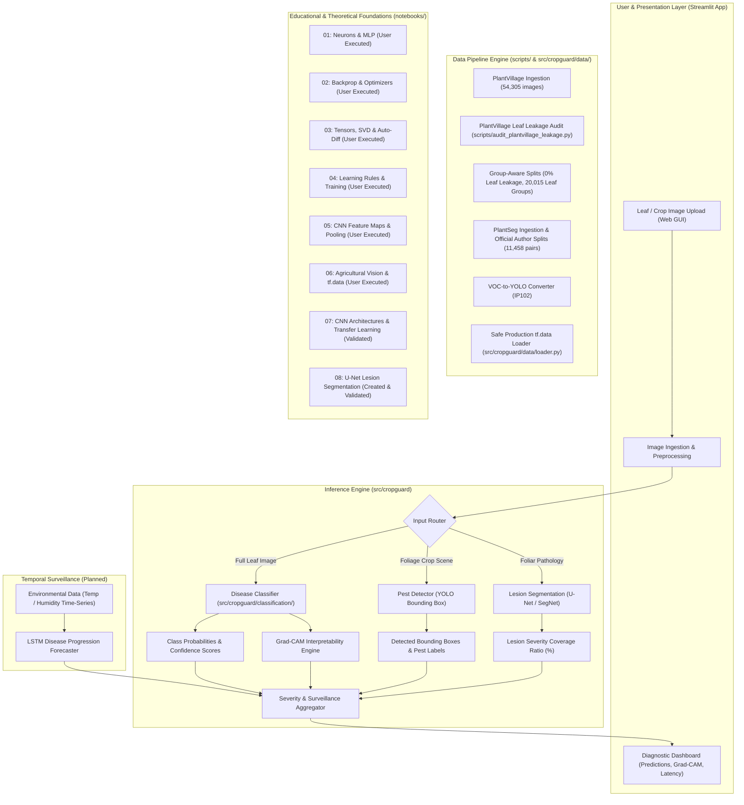

# CropGuard AI — System Architecture & Design Specification

**Status:** Production Implementation Completed  
**Current Phase:** Final Product Build (Tri-Model Web Application: ResNet50 + U-Net + YOLO26n)  
**Target Deployment:** Local Decision-Support Dashboard (`http://localhost:8501`, WSL2 / Linux)  
**Maintainer:** Saksham Garg  

---

## 1. High-Level System Architecture

CropGuard AI is organized into modular decoupled subsystems spanning educational fundamentals, data ingestion pipelines, multi-task deep learning inference, and interactive visualization.



---

## 2. Subsystem Responsibilities

### 2.1 Educational Foundations Subsystem (`notebooks/`)
- **Responsibility:** Provide interactive, visual, step-by-step mathematical implementations of fundamental deep learning concepts matching UPES CSAI3027P units.
- **Components:**
  - `01_neurons_and_mlp.ipynb`: **[Executed]** Artificial neurons, threshold gates, XOR non-linear separability.
  - `02_backpropagation_and_optimizers.ipynb`: **[Executed]** Analytical gradients, computational graphs, SGD, Momentum, Adam.
  - `03_tensor_operations_broadcasting_and_svd.ipynb`: **[Executed]** Multidimensional tensors, broadcasting, `tf.GradientTape`, SVD leaf compression.
  - `04_learning_rules_and_training.ipynb`: **[Executed]** Hebbian, competitive, error-correction, Boltzmann learning, function approximation.
  - `05_cnn_feature_maps_and_pooling.ipynb`: **[Executed]** 2D/3D convolutions, Sobel filters, padding, stride, pooling, receptive field growth, dense parameter calculus, feature map extraction.
  - `06_agricultural_dataset_exploration.ipynb`: **[Executed]** Agricultural vision modalities, PlantVillage audit, chlorophyll degradation histograms, imbalance calculus, PlantSeg lesion overlays, VOC-to-YOLO conversion, and live 231 FPS `tf.data` pipeline.
  - `07_cnn_architectures_and_transfer_learning.ipynb`: **[Executed]** Custom Foliar CNN vs MobileNetV2 vs ResNet50, Depthwise Separable Convolutions, Residual skip connections, Model-specific preprocessing, Inverse-frequency class weights, GPU inference profiling, diagnostic error analysis, agricultural confounding/domain shift, hands-on exercises & 10 viva questions. All 13 code cells executed by user with outputs permanently preserved.
  - `08_unet_lesion_segmentation.ipynb`: **[Created & Validated]** U-Net architecture for dense pixel-level foliar lesion segmentation, Classification vs Segmentation paradigm, Contracting Encoder and Expanding Decoder pathways, Skip Connection feature concatenation and gradient flow, PlantSeg annotation format (disease ID binarization to {0, 1} and EXIF orientation handling), Receptive Field expansion calculus, Compound BCE + Dice Loss for severe class imbalance, Sørensen-Dice and IoU evaluation metrics, Lesion Severity Index extraction, and 10 comprehensive viva voce questions with detailed academic answers. Code cells strictly unexecuted.
- **Execution Policy:** Interactive manual execution by user in IDE using dedicated `CropGuard AI (.venv)` kernel. Zero automated headless wiping.

---

### 2.2 Data Pipeline Subsystem (`scripts/`, `src/cropguard/data/`, & `data/`)
- **Responsibility:** Ingest raw archives, audit image integrity, record spatial dimensions, compute MD5 hashes, prevent physical-leaf data leakage, generate leak-free group-aware partitions, and supply safe high-throughput `tf.data` input streams.
- **Key Modules:**
  - `scripts/prepare_plantvillage.py`: Extracts and indexes 54,305 color images across 38 classes, generates manifests and quality reports.
  - `scripts/audit_plantvillage_leakage.py`: Audits physical-leaf leakage, isolates exact MD5 duplicates, and generates group-aware splits (`data/splits/classification_group_aware/`) with strictly 0% leaf leakage.
  - `scripts/generate_splits.py`: Enforces legacy deterministic, class-stratified 70/15/15 partitions (`data/splits/classification/`).
  - `scripts/prepare_plantseg.py`: Validates image-mask spatial parity, computes lesion coverage ratios, audits Zenodo licensing (v6 CC-BY-4.0), and ingests official author splits (11,458 pairs).
  - `scripts/prepare_ip102.py`: Converts PASCAL VOC XML annotations to normalized YOLO format ($[x_c, y_c, w, h] \in [0, 1]$).
  - `src/cropguard/data/loader.py`: Safe configurable production `tf.data` loader with model-specific `preprocess_fn` support (`cache_mode=None` default to avoid 30.45 GiB RAM overflow, disk caching, AUTOTUNE prefetching).
  - `scripts/inspect_datasets.py`: Audits physical disk footprints, sample counts, and split disjointness.
  - `scripts/visualize_samples.py`: Produces diagnostic publication plots in `docs/images/`.

---

### 2.3 Foliar Disease Classification Subsystem (`src/cropguard/classification/`)
- **Responsibility:** Multi-class classification across 38 crop-pathology categories using group-aware partitions and inverse-frequency loss weights ($w_k$).
- **Architectures (`models.py`):**
  - **Custom Foliar CNN:** 4-stage convolutional baseline with BatchNorm, ReLU, and Global Average Pooling (429,158 params, 427,686 trainable).
  - **MobileNetV2 Classifier:** Pretrained ImageNet feature extractor with Depthwise Separable Convolutions & Inverted Residuals (2,600,806 params, 340,262 P1 trainable, 1,688,742 P2 fine-tuning trainable).
  - **ResNet50 Classifier:** Pretrained ImageNet backbone with Deep Residual Bottleneck blocks (24,130,214 params, 538,406 P1 trainable, 10,508,070 P2 fine-tuning trainable).
  - Fine-tuning helper `set_backbone_trainable_layers` for progressive layer unfreezing with explicit `BatchNormalization` freezing to prevent pretrained population statistics degradation.
- **Model-Specific Preprocessing (`preprocessing.py`):**
  - Custom CNN: Scales $[0, 255]$ linearly to $[0.0, 1.0]$.
  - MobileNetV2: Normalizes $[0, 255]$ to $[-1.0, 1.0]$ via $(x / 127.5) - 1.0$.
  - ResNet50: Converts RGB to BGR and subtracts ImageNet channel means $[103.939, 116.779, 123.68]$.
  - Class weights computation: $w_k = \frac{N}{K \cdot N_k}$ derived exclusively from training partition.
- **Training Utilities (`training.py`):**
  - Compilation with Adam optimizer, Sparse Categorical Crossentropy, label smoothing support, and EarlyStopping/ReduceLROnPlateau/ModelCheckpoint/TensorBoard callbacks.
- **Evaluation Suite (`evaluation.py`):**
  - Pure NumPy computation of Accuracy, Macro Precision, Macro Recall, Macro F1, Per-Class Recall, and Confusion Matrix.
  - Pure NumPy One-vs-Rest Multiclass ROC-AUC via Wilcoxon-Mann-Whitney U statistic ($O(K \cdot N \log N)$) with tie rank resolution, eliminating any external scikit-learn or scipy dependency.
  - High-resolution GPU inference latency profiling (ms/image and FPS throughput with warm-up).
  - Diagnostic confusion matrix visualization generator (`save_confusion_matrix_plot`).

### 2.3.1 Standalone Production CLI Training Pipeline (`train.py`)
- **CLI Interface:** `src/cropguard/classification/train.py` provides an interrupt-resilient, production-grade CLI runner:
  ```bash
  python src/cropguard/classification/train.py --model {custom_cnn,mobilenet_v2,resnet50} [options]
  ```
- **Two-Phase Transfer Learning Strategy:**
  - **Phase 1 (Feature Extraction):** Backbone weights frozen; top classification head trained with Adam $\eta = 10^{-3}$ and early stopping patience.
  - **Phase 2 (Fine-Tuning):** Top $L$ backbone layers unfrozen (`--fine-tune-layers`, default 25), all `BatchNormalization` layers explicitly locked (`trainable = False`), fine-tuned with reduced learning rate $\eta = 10^{-5}$.
  - Custom CNN automatically bypasses Phase 2 and trains end-to-end in Phase 1.
- **Production Artifact Directory Layout:**
  ```text
  models/classification/production/<model_name>/
  ├── best_model.keras             # Top validation loss/accuracy checkpoint
  ├── training_history.csv         # Epoch-by-epoch loss, accuracy, lr metrics
  ├── config.json                  # Complete runtime arguments & partition metadata
  ├── validation_metrics.json      # Final post-training evaluation metrics & ROC-AUC
  ├── confusion_matrix.png         # Diagnostic 38x38 heatmap
  └── tensorboard/                 # Real-time event logs for TensorBoard
  ```
- **Evaluation Discipline & Test Partition Isolation:**
  - The test split (`data/splits/classification_group_aware/test.csv`, 10,999 images) is **strictly quarantined and untouched**.
  - All post-training evaluation and early stopping are performed exclusively on the validation split (`data/splits/classification_group_aware/val.csv`, 8,085 images).
- **Dry-Run Validation (`--dry-run`):**
  - Immediate $< 3$s preflight check verifying CLI arguments, dataset paths, model instantiation, layer counts, GPU memory growth, and output directory scaffolding without dispatching GPU training iterations.

---

### 2.4 Foliar Pathology Segmentation Subsystem (`src/cropguard/segmentation/`)
- **Responsibility:** Execute dense pixel-level foliar lesion segmentation and extract objective foliar disease severity metrics from PlantSeg paired annotations.
- **Architectures (`models.py`):**
  - **U-Net Architecture (`build_unet`):** Standard symmetric encoder-decoder network (Ronneberger et al., 2015).
    - **Contracting Encoder:** 4 stages of `[Conv2D(3x3) -> BatchNorm -> ReLU] x 2` + `MaxPooling2D(2x2)` (filters: 32, 64, 128, 256).
    - **Bottleneck:** Deepest semantic latent representation (`Conv2D(512, 3x3) -> BatchNorm -> ReLU x 2`).
    - **Expanding Decoder:** 4 stages of `Conv2DTranspose(2x2, stride=2)` (or `UpSampling2D`) + channel concatenation with corresponding encoder skip connections (`[dec_up || enc_skip]`) + `[Conv2D(3x3) -> BatchNorm -> ReLU] x 2`.
    - **Segmentation Head:** $1 \times 1$ `Conv2D(filters=1, activation='sigmoid')` yielding dense continuous probability map $\hat{\mathbf{P}} \in [0, 1]^{H \times W \times 1}$.
    - **Parameter Count:** **7,771,873 total parameters** (7,765,985 trainable, 5,888 non-trainable BatchNorm statistics).
- **Preprocessing & Alignment (`preprocessing.py`):**
  - Resolves camera EXIF orientation flags (`ImageOps.exif_transpose`) ensuring alignment for smartphone JPEGs.
  - Normalizes leaf imagery to $[0.0, 1.0]$ float32.
  - Binarizes raw PlantSeg masks (where background is 0 and lesion pixels carry integer disease IDs $[1, 115]$) via $(M > 0) \to \{0.0, 1.0\}$.
  - Resizes images via Bilinear interpolation and masks via **Nearest-Neighbor interpolation** to strictly preserve discrete binary boundaries.
- **Data Loading Pipeline (`data.py`):**
  - `load_segmentation_records`: Ingests split CSVs.
  - `build_segmentation_dataset`: High-throughput, memory-bounded `tf.data` pipeline supporting streaming directly from `Plantseg.zip` or local disk paths with configurable batch size, subset sampling for quick experiments, and `cache_mode=None` default (ADR-006).
- **Loss Formulations & Training (`training.py`):**
  - **Dice Loss:** $\mathcal{L}_{\text{Dice}} = 1 - \frac{2 \sum y_i \hat{p}_i + \epsilon}{\sum y_i + \sum \hat{p}_i + \epsilon}$, directly optimizing structural overlap under severe foliar class imbalance (lesions covering 1–8% of leaf area).
  - **Combined BCE + Dice Loss (`BCEDiceLoss`):** $\mathcal{L}_{\text{Compound}} = 0.5 \mathcal{L}_{\text{BCE}} + 0.5 \mathcal{L}_{\text{Dice}}$, combining smooth convex cross-entropy gradients with structural boundary sensitivity.
  - Callbacks factory: `get_segmentation_callbacks` configuring `ModelCheckpoint(monitor='val_dice_coefficient', mode='max')`, `EarlyStopping`, and `ReduceLROnPlateau`.
- **Evaluation & Clinical Severity (`evaluation.py`):**
  - Pure NumPy and TensorFlow metric implementations of Sørensen-Dice coefficient and Jaccard Index (IoU).
  - Full confusion metrics: Precision, Recall, Specificity, TP, FP, TN, FN.
  - **Foliar Lesion Severity Index:** $\mathcal{S} = \frac{\sum_{i, j} \hat{M}_{i, j}}{H \cdot W} \times 100\%$, extracting the exact percentage of infected photosynthetic leaf surface area.
- **Standalone Training CLI (`train.py`):**
  - Production CLI at `src/cropguard/segmentation/train.py` orchestrating end-to-end training and evaluation on PlantSeg.
  - Hyperparameter flags: `--epochs` (default: 20), `--batch-size` (default: 8), `--learning-rate` (default: 1e-4), `--bce-weight` (0.5), `--dice-weight` (0.5), `--patience-early` (5), `--patience-lr` (3).
  - Architecture flags: `--base-filters` (32), `--depth` (4).
  - Execution modes: `--dry-run` (immediate preflight validation in < 3s), `--smoke-test` (2-epoch verification on 32 train, 16 val), `--subset-train`, `--subset-val`, `--eval-only`.
  - **Strict Test Quarantine:** Programmatically enforces that `data/splits/segmentation/test.csv` (2,295 pairs) is quarantined and never accessed.
  - **Structured Artifact Tree:**
    ```
    models/segmentation/{production,smoke_test}/unet/
    ├── best_model.keras             # Top validation Dice checkpoint
    ├── training_history.csv         # Epoch-by-epoch loss, Dice, IoU, lr trajectory
    ├── config.json                  # Runtime arguments & model metadata
    ├── validation_metrics.json      # Final post-training validation metrics & latency profile
    └── sample_predictions/          # Multi-panel diagnostic figures
        ├── sample_01.png            # Original RGB | Ground Truth | Pred Prob | Overlay
        └── ...
    ```

---

### 2.5 Pest Detection Engine (`src/cropguard/detection/`)
- **Responsibility:** Identify, classify, and localize insect pests in foliage images.
- **Architecture:** YOLO (You Only Look Once) architecture for real-time single-stage bounding-box regression.
- **Interface Contract:**
  ```python
  def detect_pests(image_array: np.ndarray, conf_threshold: float = 0.4) -> list[dict]:
      """
      Inputs: image_array: Shape (H, W, 3), uint8 RGB
      Returns: [
          {
              "pest_name": str,             # e.g., "Aphid"
              "confidence": float,          # e.g., 0.88
              "box_xyxy": [int, int, int, int] # [xmin, ymin, xmax, ymax]
          }, ...
      ]
      """
  ```

---

### 2.5 Insect Pest Detection Subsystem (`src/cropguard/detection/`)
- **Responsibility:** Bounding-box localization and category identification of agricultural insect pests using YOLO26n and the IP102 benchmark taxonomy.
- **Components:**
  - `models.py`: Model loader (`load_pest_detector`) binding Ultralytics `YOLO` to CUDA accelerator (`NVIDIA GeForce RTX 5060 Laptop GPU`). Dynamically checks for fine-tuned production weights (`models/pest_detection/production/yolo26n/best.pt`) and falls back to verified base weights (`yolo26n.pt`, 3.15M parameters).
  - `inference.py`: Production inference runner (`predict_pests`) executing forward pass, clipping coordinates $[x_1, y_1, x_2, y_2]$ to physical image boundaries, computing normalized YOLO box coordinates, and formatting confidence scores. Provides zero-detection safety handling (returns 0 detections without crashing or creating false positives).
  - `classes.py`: Official IP102 taxonomy loader (`load_ip102_classes`) and formatter (`format_pest_name`) managing all 102 benchmark pest classes established by Wu et al. (CVPR 2019).
  - `train.py`: Interrupt-resilient training CLI supporting `--epochs`, `--batch-size`, `--imgsz`, `--dry-run`, dynamic GPU memory growth, and empirical dataset availability validation.
- **Zero-Detection Safety Policy:** When evaluating pure foliar samples where no insect pest meets confidence threshold $\tau_{\text{pest}}$, the detector explicitly reports `0 insect pests detected`. It never converts background plant matter into false insect detections.

---

### 2.6 Decision Support & Web UI (`app/app.py` & `src/cropguard/inference.py`)
- **Responsibility:** Deliver a clean, beginner-friendly, browser-accessible user interface for agriculturalists and academic evaluation.
- **Technology:** Streamlit dashboard running locally on `http://localhost:8501`.
- **Architecture & Tri-Model Inference Workflow:**
  1. **Image Ingestion & Normalization:** Supports JPG, JPEG, PNG. Normalizes camera EXIF orientation flags (`ImageOps.exif_transpose`) and converts to standard RGB.
  2. **Cached Production Models (`@st.cache_resource`):**
     - **ResNet50:** 24.13M parameters, 38 PlantVillage classes, 98.42% test accuracy. Preprocessing: $(224, 224, 3)$, Caffe BGR mean subtraction.
     - **U-Net:** 7.77M parameters, foliar lesion segmentation, 63.48% test Dice. Preprocessing: $(256, 256, 3)$, $[0.0, 1.0]$ float32 normalization.
     - **YOLO26n:** 3.15M parameters, insect pest detection, 102 IP102 categories. Preprocessing: $(640, 640, 3)$ multi-scale tensor.
  3. **Diagnostic Disease Classification Card:** Predicted disease entity, confidence percentage badge, health status flag (Healthy vs Diseased), and top-3 candidate progress bars.
  4. **Foliar Lesion Segmentation 3-Panel Display:** Original leaf, binary lesion mask ($\tau = 0.50$), and semi-transparent crimson overlay ($\alpha = 0.45$).
  5. **Insect Pest Detection Section:** Displays bounding-box annotations when pests are present, or a clean `🟢 NO INSECT PESTS DETECTED` card when zero pests are found, accompanied by architectural status notes.
  6. **Severity Quantification:** Affected leaf area percentage calculated strictly from mask pixels $\ge \tau$:
     $$\text{Lesion Coverage (\%)} = \frac{\sum \mathbf{1}(\hat{Y} \ge \tau)}{H \times W} \times 100$$
  7. **Export Suite:** One-click downloads for diagnostic summary JSON reports (encompassing all 3 models), lesion overlay PNG graphics, and pest detection bounding box PNGs.
  8. **Scientific Disclaimer:** Formal boundaries distinguishing taxonomic classification (pathogen identity) from visible lesion segmentation (tissue damage) and insect pest localization, acknowledging lab-to-field domain shifts.

---

## 3. Production Data Flow Specification

```text
[User Leaf Image: JPG / JPEG / PNG]
              │
              ▼
[Image Normalization: EXIF Orientation Transpose + RGB Conversion]
              │
      ┌───────┼────────────────────────┬────────────────────────┐
      ▼                                ▼                        ▼
[Classification Preproc]      [Segmentation Preproc]   [Detection Multi-Scale]
* Resize to (224, 224)        * Resize to (256, 256)   * Tensor shape (640, 640)
* RGB -> BGR Conversion       * Scale to [0.0, 1.0]    * Normalized [0, 1] bounds
* Subtract ImageNet Means     * Shape: (1, 256, 256, 3)         │
* Shape: (1, 224, 224, 3)              │                        ▼
      │                                ▼               [YOLO26n (3.15M params)]
      ▼                       [U-Net (7.77M params)]   * Multi-scale feature pyramid
[ResNet50 (24.13M params)]    * Encoder + Decoder      * Bounding box NMS (tau=0.25)
* Forward pass (frozen)       * Skip connections + Sig          │
* Softmax probabilities                │                        ▼
      │                                ▼               [Pest Detections & Boxes]
      ▼                       [Probability Map]        * Zero-pest safety handling
[Top-3 Disease Predictions]   * Binarize (tau = 0.50)  * Category labels & coords
* Primary class & conf %      * Coverage ratio (%)     * High-contrast visual overlay
* Top-3 candidate ranking              │                        │
      │                                ▼                        │
      │                       [Lesion Overlay Image]            │
      │                       * Crimson mask [220,38,38]        │
      │                       * Alpha = 0.45                    │
      │                                │                        │
      └────────────────────────────────┼────────────────────────┘
                                       ▼
                  [Tri-Model Diagnostic Dashboard (Streamlit)]
                  * Disease identity card with confidence badge
                  * 3-panel lesion segmentation with severity tier
                  * Insect pest detection card (zero-pest verified)
                  * Hardware latency metrics (ResNet50 + U-Net + YOLO26n)
                  * Full JSON diagnostic report export
                  * PNG lesion overlay and pest detection downloads
                  * Scientific & agricultural disclaimer
```

---

## 4. Dual Runtime Co-Existence Architecture

To support state-of-the-art vision models while eliminating library conflicts in Python 3.14:
- **TensorFlow / Keras Runtime (TF 2.22.0rc0, Keras 3.16-dev):**
  - Manages ResNet50 (38-class leaf classification) and U-Net (foliar lesion segmentation).
  - Configured with dynamic memory growth (`TF_FORCE_GPU_ALLOW_GROWTH=true`) to avoid pre-allocating full 8 GB VRAM.
- **PyTorch / Ultralytics Runtime (PyTorch 2.15.0+cu132, Ultralytics 8.4.215):**
  - Manages YOLO26n (3.15M parameters) for insect pest bounding-box detection.
  - Native CUDA acceleration on RTX 5060 Laptop GPU.
- **Environment Parity:** Both engines operate inside the same virtual environment (`.venv`) without dependency breakage (`pip check` passes with 0 errors).

---

## 5. Hardware & Software Dependencies

### Runtime Hardware Requirements:
- **Processor:** x86_64 CPU with AVX2 instruction support.
- **GPU Accelerator:** NVIDIA GeForce RTX 5060 Laptop GPU (8GB VRAM) via WSL2 direct driver pass-through (Driver: 596.21, CUDA 13.2).
- **Host Memory:** Minimum 8GB RAM available to WSL2.

### Pinned Core Software:
- `python == 3.14.4`
- `tensorflow == 2.22.0rc0`
- `torch == 2.15.0+cu132`
- `ultralytics == 8.4.215`
- `keras-nightly == 3.16.0.dev2026110903`
- `numpy == 2.5.4`
- `streamlit == 1.67.0`
- `pytest == 9.2.0`
- `matplotlib == 3.11.2`
- `pillow == 13.0.0`
- `streamlit == 1.67.0`
- `ipykernel == 7.4.0`
- `pytest == 9.2.0` (61/61 passing unit tests)
